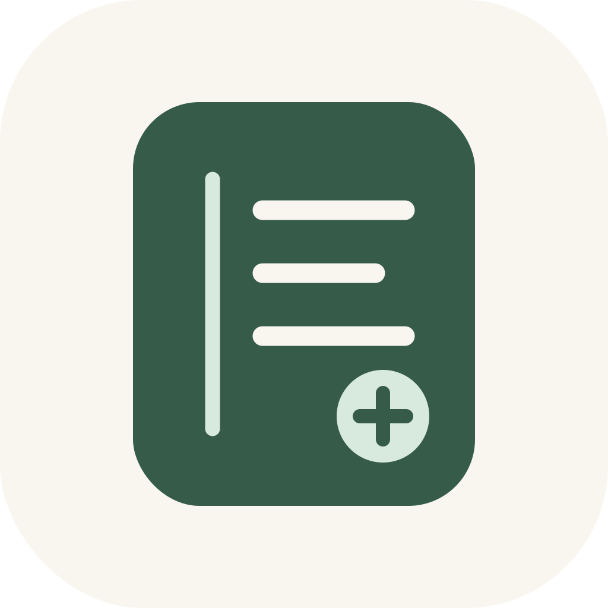
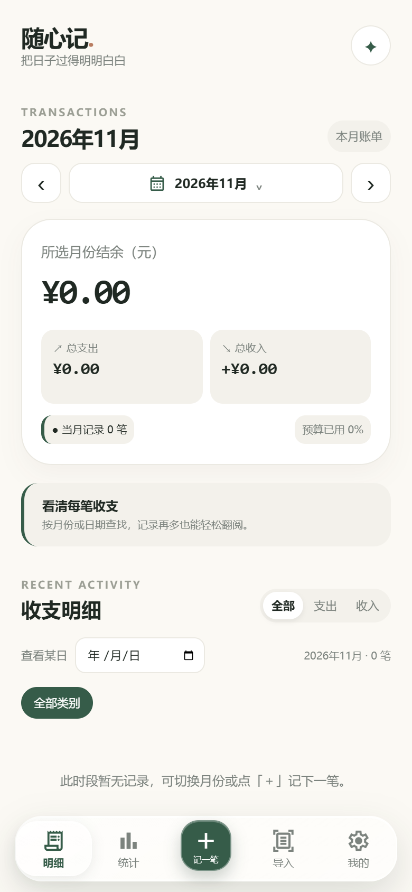
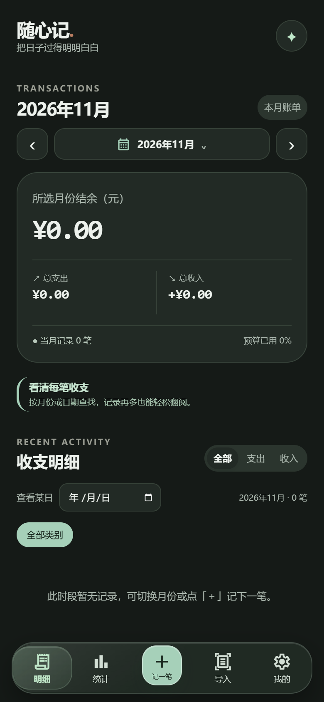
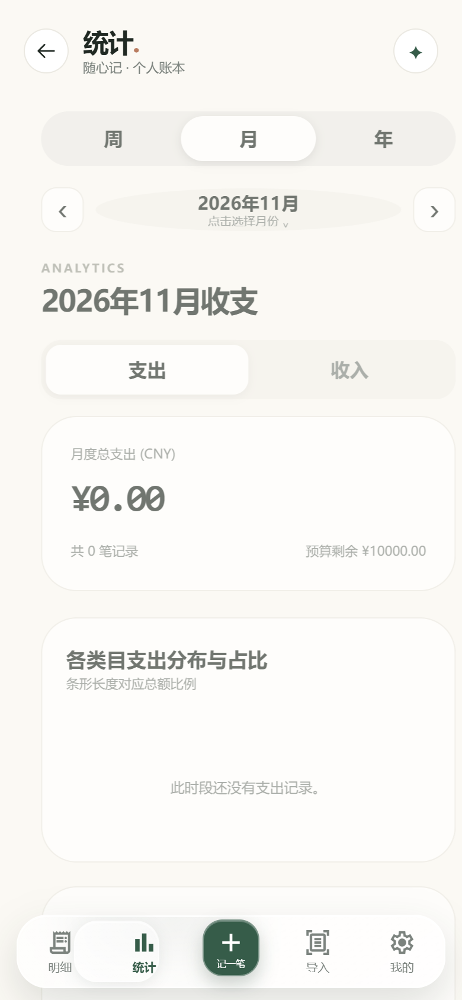
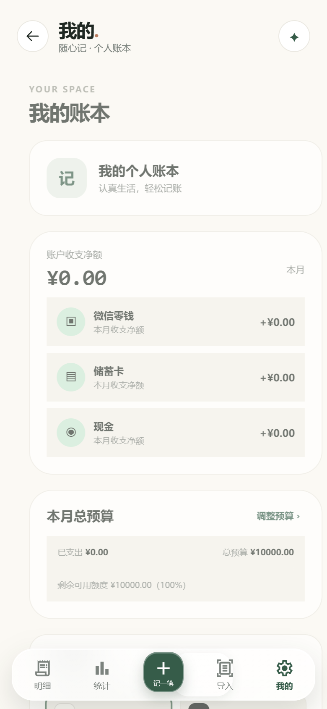

<div align="center">
  

  # 随心记

  **把日子过得明明白白。**

  一款无需登录、离线可用的个人记账 App。账单留在自己的设备上，由自己决定何时导出。

  
  
  
  
</div>

## 界面

以下截图来自**空账本**，安装包不含演示或测试账单。

| 米白主题 | 深色主题 | 统计 | 我的账本 |
| :---: | :---: | :---: | :---: |
|  |  |  |  |

## 功能

- **记账**：手动新增、编辑和单条删除支出、收入与转账；按账户和类别整理。
- **查找**：首页切换月份、选择具体日期、筛选收支与类别；长列表向下滑动继续加载。
- **统计**：查看周、月、年的支出与收入，快速选择历史时段、类别分布及趋势。
- **导入**：支持 CSV、Excel（`.xlsx`、`.xls`）、可提取文字的 PDF、Word（`.docx`）；已适配微信支付账单流水 Excel 与交易明细证明 PDF，按交易单号识别重复项。
- **备份**：导出 CSV。手机端通过系统分享菜单选择保存位置；换机前请主动备份。
- **外观**：米白、深色、青绿、暖杏和自定义强调色；底部玻璃导航。
- **清理**：可删除单条记录，也可确认后清空账单、预算和主题设置。

> 扫描件 PDF、图片账单和旧版 `.doc` 文件暂不支持文字识别。不同机构的账单格式也可能需要人工核对。

## 下载与安装

从 [v1.0.1 下载页](https://github.com/skissnsbsjzjz6331/suixinji/releases/tag/v1.0.1) 取得 Android 测试安装包：

| 版本 | 下载 | 适用设备 |
| --- | --- | --- |
| 标准版 | [suixinji-standard-v1.0.1.apk](https://github.com/skissnsbsjzjz6331/suixinji/releases/download/v1.0.1/suixinji-standard-v1.0.1.apk) | 常规 Android 7+ 设备 |
| 华为版 | [suixinji-huawei-v1.0.1.apk](https://github.com/skissnsbsjzjz6331/suixinji/releases/download/v1.0.1/suixinji-huawei-v1.0.1.apk) | 华为及鸿蒙兼容设备，不依赖 Google 服务 |

两款 APK 是 Debug 签名的测试安装包，可用于个人手机试用。它们使用不同的应用 ID，数据互不共享。**从 1.0.0 更新前请先导出 CSV 备份**；测试包的签名随构建变化，通常需要卸载旧版后安装新版，再导入备份。GitHub Actions 还保留了构建记录与临时产物。

iOS 工程位于 [`ios/`](ios/)。工作流会检查 iOS 模拟器构建；**iPhone 真机安装需要在 macOS/Xcode 中使用自己的 Apple 开发者签名**，仓库不包含可直接安装的签名 IPA。详细步骤见 [构建说明](docs/BUILD.md)。

## 本地开发

需要 Node.js 22 或更新版本。

```bash
npm ci
npm run dev
```

```bash
npm run build
npx cap sync
```

Web 预览保留了 iPhone/Android 设备框；安装到手机后会自动使用原生全屏布局。应用主体在 [`src/Prototype.tsx`](src/Prototype.tsx)，样式在 [`src/prototype.css`](src/prototype.css) 与 [`src/native.css`](src/native.css)。

## 数据与隐私

没有账号、服务器、广告 SDK 或分析 SDK。账本记录保存在当前安装实例的本地 WebView 存储中；浏览器预览与手机安装包之间不会自动同步。卸载应用、清除应用数据或换机之前，请先导出 CSV。Android 已关闭系统应用数据自动备份。详见 [隐私说明](docs/PRIVACY.md)。

## 版本

当前版本 **1.0.1**。更新记录见 [CHANGELOG.md](CHANGELOG.md)。

